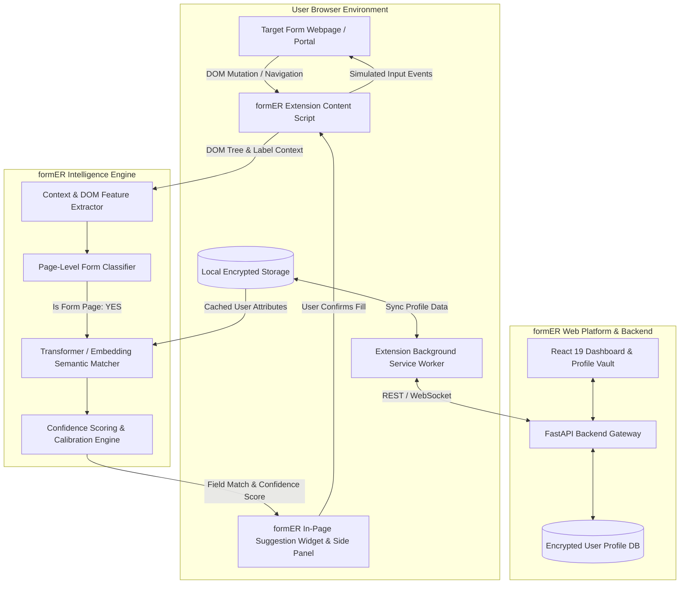
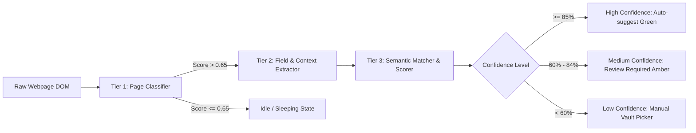
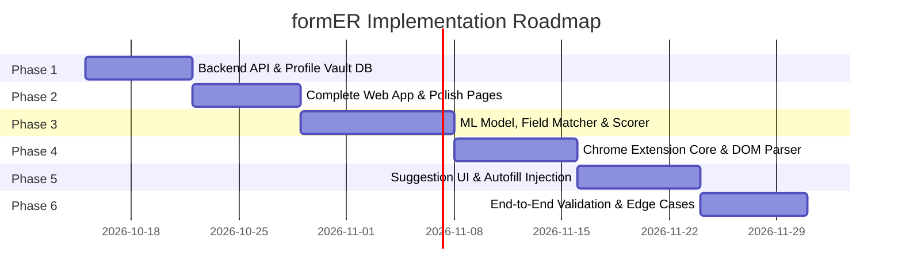

# formER: End-to-End System Architecture & Phased Implementation Roadmap

This document outlines the technical design, machine learning architecture, browser extension specifications, and phased development roadmap for **formER**—an intelligent, suggestion-driven form-filling platform.

---

## 1. System Vision & Architecture Overview

formER eliminates repetitive data entry on complicated multi-step portals (university admissions, competitive examinations, job portals, and government filings). The system operates on a **suggestion-first, human-in-the-loop** paradigm: it detects form fields, predicts semantics with confidence scoring, presents non-intrusive suggestions, and fills the form only upon user review and approval.

### High-Level Architecture Diagram



---

## 2. Technology Stack Matrix

| Component | Technology | Rationale & Purpose |
| :--- | :--- | :--- |
| **Frontend Web App** | React 19, Vite, Tailwind CSS v4, React Router v7 | Responsive, high-performance profile vault, audit logs, and settings manager. |
| **Browser Extension** | Chrome Manifest V3, Webpack / Vite, Vanilla JS & Shadow DOM | Ensures universal compatibility across Chrome, Edge, and Brave with zero stylesheet leakage onto host pages. |
| **Backend & API** | Python FastAPI, Pydantic, SQLAlchemy, Alembic | Async, ultra-fast API response times, native Python ML integration. |
| **Database & Security** | PostgreSQL / SQLite + SQLCipher, AES-256-GCM encryption | Encrypted at rest; supports zero-knowledge client-side encryption keys. |
| **ML & NLP Engine** | `sentence-transformers` (`all-MiniLM-L6-v2`), ONNX Runtime, spaCy / regex rules | Hybrid pipeline combining deterministic rule-based matching with semantic dense-vector similarity (<50ms inference). |
| **Testing Frameworks** | Pytest, Vitest, Playwright (for Chrome Extension E2E testing) | Automated validation across complex forms and real-world portal layouts. |

---

## 3. Machine Learning & Form Detection Architecture

The ML system operates as a **three-tier classification and matching pipeline**:



### Tier 1: Page-Level Form Classifier
Determines whether the active tab is an actionable application or registration form.
* **Feature Extraction**:
  * Form element count (`<form>`, `<input>`, `<select>`, `<textarea>`).
  * Actionable keywords in headers and URLs (`register`, `apply`, `admission`, `candidate`, `application`, `personal details`, `academic qualifications`).
  * Submit action buttons presence (`Submit`, `Proceed to Step 2`, `Save and Continue`).
* **Model**: Fast light-weight heuristic + Logistic Regression / Naive Bayes classifier running in the background worker or content script (<10ms).

### Tier 2: Field & Contextual Feature Extractor
When a form is detected, the content script inspects each interactable field and synthesizes a **Context Vector**:
* Explicit labels (`<label for="...">`, parent `<label>`).
* Attribute heuristics (`name`, `id`, `placeholder`, `aria-label`, `autocomplete`).
* Proximity text: 
  * Preceding text nodes within the same container.
  * Table headers if the input is within an HTML table (common in Indian university grade sheets).
  * Section headers (`h1`-`h4`, `fieldset` legends) such as "Class 10th Details" vs "Class 12th Details".

### Tier 3: Semantic Field Matcher & Scoring Algorithm
Matches extracted field contexts against the structured attributes in the user's profile:

```
User Profile Keys:
- personal.fullName
- personal.fatherName
- personal.motherName
- personal.dob
- education.tenth.rollNumber
- education.tenth.board
- education.tenth.percentage
- education.twelfth.percentage
- contact.permanentAddress.pincode
...
```

* **Hybrid Matching Engine**:
  1. **Deterministic Rule Engine (Exact / Regex)**:
     * Standard HTML autocomplete attributes (`autocomplete="email"`, `type="date"`).
     * Common exact tokens (`"dob"`, `"pincode"`, `"phone"`, `"ssc %"`).
     * Rule confidence: `1.0` (Instant match).
  2. **Dense Vector Semantic Embedding (Transformer)**:
     * Computes cosine similarity between `Embedding(FieldContext)` and `Embedding(ProfileAttributeDescription)`:
       $$\text{Similarity}(F_i, P_j) = \frac{\vec{F_i} \cdot \vec{P_j}}{\|\vec{F_i}\| \|\vec{P_j}\|}$$
     * Uses a distilled sentence transformer (e.g., `all-MiniLM-L6-v2` compiled to **ONNX Runtime** for fast CPU inference).
  3. **Section-Aware Disambiguation**:
     * Resolves ambiguities like "Percentage" by checking parent section context ("10th" vs "12th" vs "Graduation").
* **Confidence Scoring Formula**:
  $$\text{FinalScore} = w_1 \cdot S_{\text{semantic}} + w_2 \cdot S_{\text{regex}} + w_3 \cdot S_{\text{section\_match}}$$

---

## 4. Chrome Extension (Manifest V3) Architecture

The extension acts as the bridge between the user's saved data and arbitrary third-party web forms.

### Architecture Details
1. **Isolated Shadow DOM**:
   * All formER extension UI elements (floating autofill buttons, suggestion badges, inline confidence pills) are rendered inside a closed `ShadowRoot`.
   * **Why**: Prevents host webpage CSS from breaking formER UI and prevents the host site from reading extension state.
2. **Event Simulation Engine**:
   * Modern web forms built in React, Vue, or Angular ignore direct DOM property assignments (e.g. `input.value = "John"`).
   * formER uses a simulated dispatch sequence:
     ```javascript
     const nativeInputValueSetter = Object.getOwnPropertyDescriptor(
       window.HTMLInputElement.prototype, 'value'
     ).set;
     nativeInputValueSetter.call(inputElement, value);
     inputElement.dispatchEvent(new Event('input', { bubbles: true }));
     inputElement.dispatchEvent(new Event('change', { bubbles: true }));
     ```
3. **Security & Permission Model**:
   * Principle of least privilege: Permissions limited to `activeTab`, `storage`, and `scripting`.
   * Sensitive data is stored locally in `chrome.storage.local` encrypted using AES-GCM with a user-derived encryption key.

---

## 5. Phased Implementation Roadmap & Testing Plan

The project will be built and verified iteratively across **6 distinct phases**.



---

### Phase 1: Backend Foundation & Structured Profile Vault API
* **Goals**:
  * Set up FastAPI backend with SQLite/PostgreSQL storage.
  * Implement nested user profile schema (Personal, Academic, Documents, Contact, Preferences).
  * Build secure JWT authentication endpoints (`/api/auth/register`, `/api/auth/login`, `/api/profile`).
* **Deliverables**:
  * Python FastAPI application in `backend/`.
  * Pydantic schemas validating nested profile inputs.
  * Automated migration scripts (Alembic).
* **Testing Strategy**:
  * Pytest unit tests for profile CRUD operations, validation checks, and token expiry.

---

### Phase 2: Complete the Web Dashboard & Connect API
* **Goals**:
  * Convert pending prototype designs in `stitch-screens/html/` into full React components:
    * Port `history.html` $\to$ [HistoryPage.jsx](file:///d:/Final-Yr-Project/Code/FormER/frontend/src/pages/HistoryPage.jsx).
    * Port `account.html` $\to$ [AccountPage.jsx](file:///d:/Final-Yr-Project/Code/FormER/frontend/src/pages/AccountPage.jsx).
    * Port `report-issue.html` $\to$ [ReportIssuePage.jsx](file:///d:/Final-Yr-Project/Code/FormER/frontend/src/pages/ReportIssuePage.jsx).
  * Connect frontend state with backend API instead of mock `localStorage`.
  * Build profile import/export (JSON backup and restore).
* **Testing Strategy**:
  * Component tests with Vitest.
  * Form validation tests for all profile input fields (dates, marks, phone numbers).

---

### Phase 3: Machine Learning Model & Field Matching Engine
* **Goals**:
  * Train and calibrate the semantic matching engine using open form field datasets and real admission/job application templates.
  * Build an ONNX runtime inference pipeline for rapid local/server execution.
  * Implement confidence scoring and calibration logic ($[0.0, 1.0]$).
* **Deliverables**:
  * `ml_engine/` module containing preprocessing, embedding generation, and scoring classes.
  * FastAPI endpoint `/api/ml/match-fields` accepting extracted field metadata and returning matched profile paths + scores.
* **Testing Strategy**:
  * Benchmark evaluation on 100+ standard form field variations (evaluating Precision, Recall, and F1-score across ambiguous fields like "10th %" vs "12th %").

---

### Phase 4: Chrome Extension Core & DOM Extraction
* **Goals**:
  * Create `extension/` directory with Manifest V3 specification.
  * Implement background service worker for authentication sync and state management.
  * Implement content script that extracts DOM form fields, surrounding label hierarchy, and attributes.
* **Deliverables**:
  * `manifest.json`, `background.js`, `content_extractor.js`, `popup.html/jsx`.
* **Testing Strategy**:
  * Test DOM extraction on 10 test web forms (simple HTML forms, Bootstrap forms, Tailwind forms, table-based forms).

---

### Phase 5: Suggestion UI & Autofill Injection System
* **Goals**:
  * Build the in-page suggestion interface inside an isolated Shadow DOM:
    * Small badge next to detected fields displaying proposed value + confidence badge.
    * Floating formER badge in bottom-right corner showing count of detected fields (`"18 fields detected • 100% confidence"`).
    * Side Panel modal for reviewing all fields at once with "Fill All Verified" action.
  * Implement resilient event simulation for React/Vue/Angular dynamic inputs.
* **Testing Strategy**:
  * Test autofill on modern SPA frameworks (React controlled inputs, Vue `v-model`, Material-UI text fields).

---

### Phase 6: End-to-End Validation, Audit Log & Edge Cases
* **Goals**:
  * Complex field types support:
    * Dropdown selects (`<select>` and custom `div`-based custom select dropdowns).
    * Radio buttons and checkboxes (e.g. Gender, Category, Declaration).
    * Date pickers with diverse formats (`DD/MM/YYYY`, `YYYY-MM-DD`, `MM/DD/YYYY`).
  * Autofill history recording: Logs which fields were filled, domain, timestamp, and whether any value was manually edited.
  * Stress testing on real portals (university admissions, mock job portals).
* **Testing Strategy**:
  * Playwright automated end-to-end browser tests executing complete fill flows.

---

## 6. Security, Privacy & Zero-Knowledge Architecture

1. **Explicit Human Consent**: formER will **never** submit forms autonomously. Autofill only populates input fields; the user must review all filled values and manually click the final "Submit" button.
2. **Local-First Storage**: User credentials and profile values are cached directly in browser storage (`chrome.storage.local`) using AES-GCM encryption.
3. **Sensitive Field Protection**: Payment fields (Credit Card, CVV, Net Banking passwords) and OTP fields are explicitly excluded from autofill detection and logging.
4. **Transparent Audit Trail**: Every autofill action generates a local audit log so users can inspect exactly what was filled on which website.
